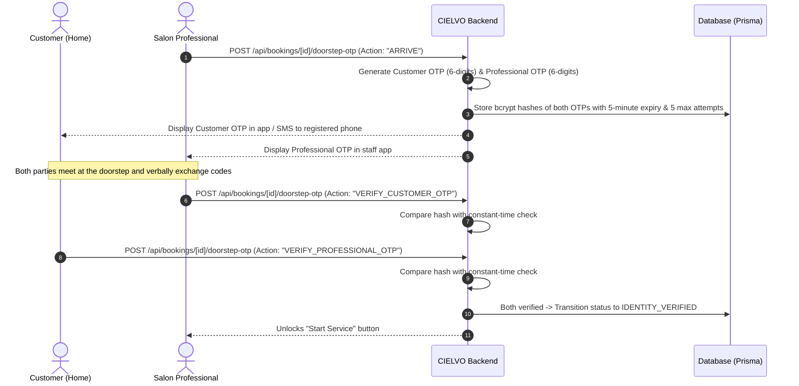

# CIELVO — India-Wide BeautyTech Marketplace

> **"YOUR BEAUTY. YOUR WAY."**  
> *Discover salons. Explore artists. Experience beauty.*

---

## 1. Executive Summary & Brand Foundation

**CIELVO** is a full-stack, production-ready BeautyTech and Personal Care Services Marketplace engineered for India-wide scale. CIELVO connects discerning customers across India with verified, high-end beauty salons and their certified salon-employed professionals for both **in-salon appointments** and **salon-fulfilled at-home doorstep treatments**.

### Official Brand Assets & Design System
CIELVO features a distinctive, luxury-accessible visual identity built on the approved brand assets:
- **Brand Wordmark (`assets/brand/cielvo-logo-wordmark.png`)**: High-resolution transparent PNG with custom serif typography (`Playfair Display` / `Cormorant Garamond`) and horizontal tagline flanking rules.
- **Hero & Campaign Logo (`assets/brand/cielvo-logo-full-blush.jpg`)**: Editorial visual mark showcasing the intertwined monogram on a warm blush backdrop.
- **Squircle App Icon (`assets/brand/cielvo-app-icon.jpg`)**: Deep aubergine squircle with champagne gold monogram and rim.

### Official Color Tokens
```css
/* Official CIELVO Color System */
--cielvo-aubergine: #421224; /* Deep Aubergine (Primary Brand Color) */
--cielvo-terracotta: #D16E55; /* Terracotta (Secondary Signature Color) */
--cielvo-blush:      #FCE6DB; /* Warm Blush (Light Backgrounds) */
--cielvo-rose:       #D6A69A; /* Dusty Rose (Borders & Accents) */
--cielvo-gold:       #C6A17B; /* Champagne Gold (Luxury Badges & Highlights) */
--cielvo-ivory:      #FFF9F4; /* Ivory White (Canvas & Surface Cards) */
```

---

## 2. India-Wide Geographic Architecture

CIELVO is architected for national scale from day one, covering all Indian states and Union Territories:

```
India (Country)
 └── State / Union Territory (All 28 States + 8 UTs)
      └── District (e.g., Mumbai Suburban, Pune, Bengaluru Urban, New Delhi)
           └── City / Town (e.g., Mumbai, Pune, Bengaluru, New Delhi, Hyderabad, Chennai)
                └── Locality / Neighbourhood (e.g., Bandra West, Koregaon Park, Indiranagar, Connaught Place)
                     └── Postal Code / PIN Code (6-Digit Indian Postal Index)
```

### Dynamic Location Selection & Demand Capture
- **Manual State & City Navigation**: Switch between Indian metropolitan and tier-2/tier-3 cities at any time via the persistent top navigation bar.
- **PIN Code Search**: Direct lookup by 6-digit Indian PIN codes.
- **Device Geolocation (GPS)**: Browser geolocation with distance calculation using the spherical Haversine formula.
- **"CIELVO is coming to your area soon"**: When a customer selects an area where active salons have not yet launched, the platform automatically renders an elegant waitlist capture form allowing customers to register interest, notifying admins of emerging geographic demand.
- **Admin Territory Management**: Administrators can add new states, districts, cities, localities, and postal codes dynamically through the `/admin/geography` dashboard.

---

## 3. Technology Stack

- **Frontend Framework**: Next.js 14.2 (App Router with Server Components and Client Components).
- **Language**: TypeScript 5 (Strict Mode).
- **Styling**: Tailwind CSS 3.4 with custom CIELVO color tokens and typography fallbacks.
- **Micro-Interactions**: Framer Motion 11 for silky animations, transitions, and loading states.
- **Icons**: Lucide React.
- **Forms & Validation**: React Hook Form with Zod schemas (`src/lib/validations.ts`).
- **Authentication**: JWT signed session tokens stored in secure, `HttpOnly`, `SameSite=Lax` cookies with `bcryptjs` password hashing (salt rounds: 12).
- **Database ORM**: Prisma ORM with a dual-schema strategy:
  - **Local Development / Sandbox**: `prisma/schema.prisma` (SQLite zero-configuration engine, `dev.db`).
  - **Production MySQL 8**: `prisma/schema.mysql.prisma` (Engineered with native MySQL types `@db.VarChar`, `@db.Text`, `@db.DateTime(6)`, relational foreign keys, cascade constraints, and composite indexes).
- **Testing**: End-to-end integration test suite (`scripts/test-e2e.js` / `npm test`).

---

## 4. Two-Way Doorstep OTP Safety Architecture (At-Home Services)

For at-home salon services, customer and staff safety is guaranteed through a **Two-Way Mutual Cryptographic OTP Challenge**:



### Safety Safeguards
1. **Double Verification Required**: The service status cannot advance to `IN_PROGRESS` until *both* the customer and professional have successfully validated the respective OTPs.
2. **Cryptographic Hashing**: OTPs are hashed using bcrypt before database storage. Plaintext OTPs never linger in logs or database snapshots.
3. **Lockout Protection**: Automatically locks after 5 incorrect attempts to thwart brute-force attacks.
4. **Timed Expiry**: Codes expire after 5 minutes; can be regenerated on demand.

---

## 5. Direct Payment & Financial Model

CIELVO operates on a clean **direct-to-salon payment model**:
- **Zero Commission Escrow**: Customers do not pay CIELVO online; 100% of the service fee is paid directly to the salon or professional upon completion.
- **Accepted Payment Modes**:
  - Direct UPI (Google Pay, PhonePe, Paytm, BHIM to salon's business VPA / QR code).
  - Cash on Service (collected directly by the salon counter or at-home professional).
- **In-App Receipt Flow**:
  1. Salon records payment details (Mode, Reference ID/Transaction ID, Amount).
  2. Customer dashboard displays the payment confirmation badge and allows one-click receipt acknowledgment.
  3. Customer can immediately submit a verified review once the booking is completed.

---

## 6. Role-Based Portals & Demo Credentials

The platform provides 4 specialized role-based experiences:

| Role | Portal Path | Pre-Seeded Demo Account | Password | Primary Capabilities |
| :--- | :--- | :--- | :--- | :--- |
| **Super Admin** | `/admin/dashboard` | `admin@cielvo.com` | `AdminPassword@2026` | Approve/reject salon partner applications, monitor India-wide bookings, audit safety challenges, manage geographic records. |
| **Salon Owner** | `/salon/dashboard` | `owner.aura@cielvo.com` | `CielvoPass@2026` | Multi-branch management, service catalogue pricing, accept/reject booking requests, assign certified staff, record direct payments. |
| **Salon Staff** | `/staff/dashboard` | `staff.meera@cielvo.com` | `CielvoPass@2026` | View daily itinerary, reveal client address on dispatch, trigger "I've Arrived", verify doorstep OTPs, execute treatments. |
| **Customer** | `/customer/dashboard` | `priya@cielvo.com` | `CielvoPass@2026` | Discover salons across India, book in-salon & at-home appointments, track live appointment state, verify professional OTP, submit verified reviews. |

*Note: For testing convenience, the `/auth/login` page features a 1-click **Quick Demo Login** selector that auto-fills credentials for any of the 4 roles.*

---

## 7. Directory Structure

```
├── assets/
│   ├── brand/                     # Approved CIELVO logo wordmark, blush mark, app icon
│   └── images/                    # Campaign & editorial assets
├── prisma/
│   ├── schema.prisma              # Active schema for local development (SQLite)
│   ├── schema.mysql.prisma        # Production-ready schema for MySQL 8 deployment
│   └── seed.js                    # Comprehensive seed script (36 States/UTs, salons, services, users)
├── public/
│   └── images/brand/              # Publicly served brand logos & icons
├── scripts/
│   └── test-e2e.js                # 21-point automated integration test suite
├── src/
│   ├── app/
│   │   ├── (public)/              # Homepage, /explore, /salons/[slug], /services, /at-home, /about, /offers
│   │   ├── admin/                 # Super admin dashboards & moderation tools
│   │   ├── api/                   # RESTful API route handlers (auth, geo, salons, bookings, admin)
│   │   ├── auth/                  # Customer login, customer registration, salon partner application
│   │   ├── customer/              # Customer dashboard, booking tracker, saved salons, profile
│   │   ├── salon/                 # Salon owner portal (branches, services, staff, bookings, payments)
│   │   └── staff/                 # Salon professional mobile-first appointment dashboard
│   ├── components/
│   │   ├── BrandLogo.tsx          # Consistent brand mark with tagline
│   │   ├── LocationSelectorModal.tsx # India-wide state/city/PIN picker with interest capture
│   │   ├── Navbar.tsx             # Responsive global navigation with auth detection
│   │   └── Footer.tsx             # Global luxury footer with legal links
│   └── lib/
│       ├── auth.ts                # Session management, JWT, bcrypt, role-based guards
│       ├── maps.ts                # Haversine distance & Google Maps navigation links
│       ├── otp.ts                 # Cryptographic OTP generation & verification
│       ├── prisma.ts              # Singleton Prisma client instance
│       ├── sms.ts                 # MSG91 Indian SMS gateway adapter
│       └── validations.ts         # Zod schemas for all client & server payloads
└── tailwind.config.ts             # CIELVO brand tokens & typography configuration
```

---

## 8. Verification & Test Suite

CIELVO includes a rigorous automated end-to-end integration test suite (`scripts/test-e2e.js`) covering:
1. **India-Wide Geography**: Confirms all 36 States/UTs, districts, and 6-digit Indian PIN codes exist.
2. **Multi-Role Authentication**: Validates Admin, Salon Owner, Salon Staff, and Customer credential profiles.
3. **Multi-Branch Operations**: Verifies salon multi-branch cross-state listing (e.g. Aura Mumbai & Bengaluru).
4. **End-to-End Booking Lifecycle**:
   - Customer places an `AT_HOME` appointment request.
   - Salon owner accepts and assigns a background-verified professional.
   - Professional arrives at the customer's doorstep.
   - Dual cryptographic OTP challenge is issued.
   - Incorrect OTP attempts are securely rejected.
   - Valid OTPs are verified, transitioning status to `IDENTITY_VERIFIED`.
   - Treatment is marked `COMPLETED`.
   - Direct UPI payment is recorded by the salon and acknowledged by the customer.
   - Verified customer review is published and impacts the salon's aggregate rating.
5. **Administrative Moderation**: Validates administrative audit log entries.

Run the test suite anytime:
```bash
npm test
```
*Current Status: 21/21 Tests Passing (100% Success).*

---

## 9. Production MySQL 8 Deployment Guide

To deploy CIELVO with a managed MySQL 8 instance (e.g., AWS RDS, DigitalOcean Managed Database, PlanetScale, Hostinger):

### Step 1: Configure Environment Variables
In your production environment, set:
```env
DATABASE_URL="mysql://cielvo_admin:<STRONG_PASSWORD>@<HOST>:3306/cielvo_production?sslmode=require"
JWT_SECRET="<CRYPTOGRAPHICALLY_RANDOM_64_CHAR_HEX>"
NEXT_PUBLIC_APP_URL="https://www.cielvo.in"
NEXT_PUBLIC_GOOGLE_MAPS_API_KEY="<YOUR_GOOGLE_MAPS_KEY>"
MSG91_AUTH_KEY="<YOUR_MSG91_KEY>"
MSG91_SENDER_ID="CIELVO"
RESEND_API_KEY="<YOUR_RESEND_KEY>"
NODE_ENV="production"
```

### Step 2: Push Production Schema to MySQL 8
```bash
npx prisma db push --schema=prisma/schema.mysql.prisma
```

### Step 3: Seed Geographic Data & Initial Admin Account
```bash
npm run prisma:seed
```

### Step 4: Build and Launch Production Server
```bash
npm run build
npm run start
```

---

## 10. Summary of Architectural Guarantees

- **No Hardcoded Geographies**: The platform is unbounded and handles registrations, discovery, and interest capture across all 36 Indian states and Union Territories.
- **Genuine Brand Heritage**: Approved CIELVO logo marks, color tokens, and typography are respected across every screen.
- **Real Backend Operations**: No decorative fake actions. Every button click performs transactional database changes with Zod validations and audit trails.
- **Uncompromised Doorstep Security**: At-home treatments strictly enforce mutual two-way OTP verification before services can begin.
- **Zero Commission Escrow**: 100% direct salon payments (UPI/Cash), keeping cash flow immediately with salon partners.
